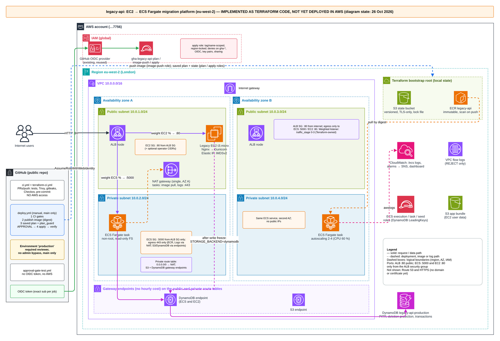

# EC2 Legacy Application

This is a **legacy Flask application** running on a single EC2 instance behind Nginx. It represents a typical "before" state of an application that needs to be migrated to a modern containerized platform.

## Credits and scope

The original application, Nginx/systemd configuration, setup scripts, legacy Terraform
and the "before" documentation in this README and `ARCHITECTURE.md` come from the
**CoderCo** EC2-to-ECS migration assignment (CoderCo Community learning project).

Migration work added on top of the starter:
- tests (`tests/`)
- container image (`Dockerfile`)
- shared DynamoDB storage (`app/storage.py`)
- ECS Fargate platform and bootstrap Terraform (`terraform/`)
- CI/CD and security gates (`.github/`, `ci/`)
- runbooks (`docs/`) and verification evidence (`evidence/`)

Start with [docs/aws-platform.md](docs/aws-platform.md) and [docs/ci-cd.md](docs/ci-cd.md).

## Assessor navigation

Status (26 Oct 2026): implemented as code and verified locally and in GitHub Actions;
**not yet deployed in AWS**.

| Topic | Where |
|---|---|
| Acceptance status (what is verified, where) | [docs/acceptance-checklist.md](docs/acceptance-checklist.md) |
| Architecture diagrams (editable draw.io + PNG) | [docs/architecture/](docs/architecture/) |
| CI/CD, OIDC, approval | [docs/ci-cd.md](docs/ci-cd.md), [docs/approval-gate-test.md](docs/approval-gate-test.md) |
| IAM permission matrix | [docs/iam-permission-matrix.md](docs/iam-permission-matrix.md) |
| Migration and rollback runbook | [docs/migration-state-runbook.md](docs/migration-state-runbook.md) |
| First AWS deployment (operator steps) | [docs/first-deployment-checklist.md](docs/first-deployment-checklist.md) |
| Readiness review and known issues | [docs/deployment-readiness-review.md](docs/deployment-readiness-review.md) |
| Evidence (redacted command output) | [evidence/](evidence/) |



## Architecture

```
Internet → EC2 Instance (Public Subnet)
              ├── Nginx (Port 80)
              └── Flask App (Gunicorn, Port 5000)
```

### Components

- **Flask Application**: Python/Flask API with REST endpoints
- **Gunicorn**: WSGI HTTP Server running the Flask app
- **Nginx**: Reverse proxy serving HTTP on port 80
- **Systemd**: Service manager for the Flask application
- **Terraform**: Infrastructure as Code for provisioning

## Application Features

The Flask API provides the following endpoints:

- `GET /health` - Health check endpoint
- `GET /api/v1/products` - List all products
- `GET /api/v1/products/{id}` - Get specific product
- `POST /api/v1/orders` - Create a new order
- `GET /api/v1/orders` - List all orders
- `GET /api/v1/stats` - Application statistics
- `GET /ready` - Readiness: `200` when storage is reachable and seeded, otherwise `503`

### Storage

`STORAGE_BACKEND=memory` (default) keeps the original in-process storage: one Gunicorn
worker only, and data is lost on restart. `STORAGE_BACKEND=dynamodb` stores products,
stock and orders in a shared DynamoDB table so EC2 and ECS can run side by side.
See [docs/migration-state-runbook.md](docs/migration-state-runbook.md).

## Prerequisites

- **AWS Account** with appropriate permissions
- **Terraform** >= 1.5.0
- **AWS CLI** configured (for manual testing)
- **SSH Key Pair** created in AWS (optional, for SSH access)

## Deployment

> **Note:** these are the original single-EC2 steps. The Terraform root now uses a
> remote S3 backend created by `terraform/bootstrap`, so a plain `terraform init` asks
> for backend settings. Follow [docs/ci-cd.md](docs/ci-cd.md) section 7 for the current,
> approval-gated deployment order.

### 1. Configure Terraform Variables

```bash
cd terraform
cp terraform.tfvars.example terraform.tfvars
# Edit terraform.tfvars with your values
```

### 2. Initialize Terraform

```bash
terraform init
```

### 3. Review Plan

```bash
terraform plan
```

### 4. Deploy Infrastructure

```bash
terraform apply
```

This will create:
- VPC with public and private subnets
- Internet Gateway and Route Tables
- Security Groups
- EC2 instance with Elastic IP
- S3 bucket for application files
- IAM roles and policies
- (Optional) Route53 DNS record

### 5. Wait for Application Setup

The EC2 instance will automatically:
1. Download application files from S3
2. Install system dependencies
3. Set up Python virtual environment
4. Configure Nginx
5. Start the Flask application via systemd

Check the instance status:

```bash
# Get instance IP
terraform output ec2_instance_public_ip

# SSH into instance (only if key_pair_name and ssh_allowed_cidr_blocks are set)
ssh -i ~/.ssh/your-key.pem ubuntu@<instance-ip>

# Check application logs
sudo journalctl -u flask-app -f
sudo tail -f /var/log/nginx/flask-access.log
```

### 6. Test the Application

```bash
# Get application URL
APP_URL=$(terraform output -raw application_url)
echo $APP_URL

# Health check
curl $APP_URL/health

# List products
curl $APP_URL/api/v1/products

# Create an order
curl -X POST $APP_URL/api/v1/orders \
  -H "Content-Type: application/json" \
  -d '{"product_id": 1, "quantity": 2}'
```

## Application Access

The application will be accessible via:
- **Public IP**: Use `terraform output ec2_instance_public_ip`
- **Domain Name**: If Route53 is configured, use `terraform output route53_record`

Default endpoint: `http://<ip-or-domain>/health`

## Logs

Application logs are located on the EC2 instance:

- **Application logs**: `/var/log/flask-app/`
  - `access.log` - Gunicorn access logs
  - `error.log` - Gunicorn error logs
- **Systemd logs**: `sudo journalctl -u flask-app -f`
- **Nginx logs**: `/var/log/nginx/`
  - `flask-access.log` - Nginx access logs
  - `flask-error.log` - Nginx error logs

## Service Management

```bash
# Check service status
sudo systemctl status flask-app
sudo systemctl status nginx

# Restart application
sudo systemctl restart flask-app

# View logs
sudo journalctl -u flask-app -f
```

## Troubleshooting

### Application not responding

1. Check if services are running:
   ```bash
   sudo systemctl status flask-app
   sudo systemctl status nginx
   ```

2. Check application logs:
   ```bash
   sudo journalctl -u flask-app -n 50
   tail -f /var/log/flask-app/error.log
   ```

3. Test Flask app directly:
   ```bash
   curl http://localhost:5000/health
   ```

4. Check Nginx configuration:
   ```bash
   sudo nginx -t
   sudo tail -f /var/log/nginx/flask-error.log
   ```

### Health check fails

1. Ensure Gunicorn is bound to `127.0.0.1:5000`:
   ```bash
   sudo netstat -tlnp | grep 5000
   ```

2. Test health endpoint directly:
   ```bash
   curl http://127.0.0.1:5000/health
   ```

### Permission issues

Ensure correct ownership:

```bash
sudo chown -R ubuntu:ubuntu /opt/flask-app
sudo chown -R ubuntu:ubuntu /var/log/flask-app
```

## Current Limitations (What Students Will Migrate)

This legacy setup has several limitations that make it unsuitable for production:

- ❌ **No autoscaling**: Single instance, no horizontal scaling
- ❌ **No high availability**: Single point of failure
- ❌ **Manual deployments**: No CI/CD pipeline
- ❌ **Inconsistent logging**: Logs scattered across instance
- ❌ **No observability**: Limited metrics and monitoring
- ❌ **Manual configuration**: No infrastructure as code for app config
- ❌ **No containerization**: Difficult to replicate environments
- ❌ **Single AZ**: Not resilient to AZ failures
- ❌ **No blue/green deployments**: Downtime during updates
- ❌ **Security**: App runs in public subnet with public IP

## Migration Goal

Students will migrate this application to:

- ✅ **Amazon ECS (Fargate)**: Containerized, managed service
- ✅ **Application Load Balancer**: High availability, health checks
- ✅ **Private subnets**: Enhanced security
- ✅ **Auto-scaling**: Horizontal scaling based on demand
- ✅ **CI/CD pipeline**: GitHub Actions with OIDC
- ✅ **CloudWatch**: Centralized logging and metrics
- ✅ **Multi-AZ**: High availability
- ✅ **Zero-downtime deployments**: Blue/green or rolling updates

## Cleanup

To destroy all resources:

```bash
cd terraform
terraform destroy
```

⚠️ **Warning**: This will delete all resources including the EC2 instance and data.

## Notes for Migration

When migrating to ECS, students should consider:

1. **DNS Cutover Strategy**: Use Route53 weighted routing or ALIAS record swap
2. **Health Checks**: Ensure ECS health checks pass before routing traffic
3. **Data Migration**: Consider stateful data (currently in-memory, will be lost)
4. **Monitoring**: Set up CloudWatch alarms before cutover
5. **Rollback Plan**: Keep EC2 instance running during initial cutover
6. **Testing**: Validate all endpoints on ECS before full cutover

## License

This is a learning project for CoderCo Community.
