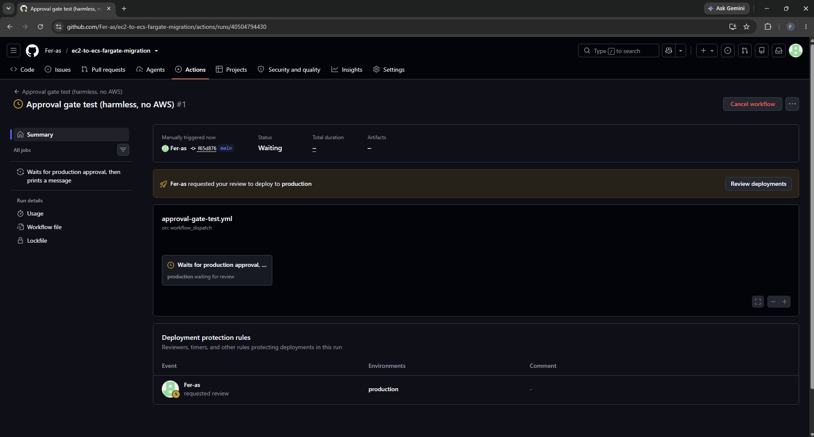
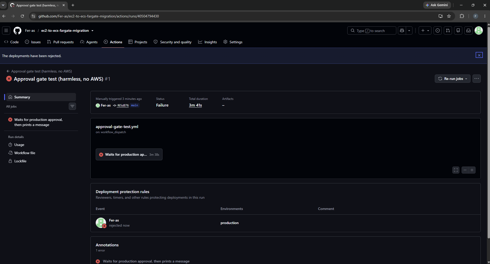
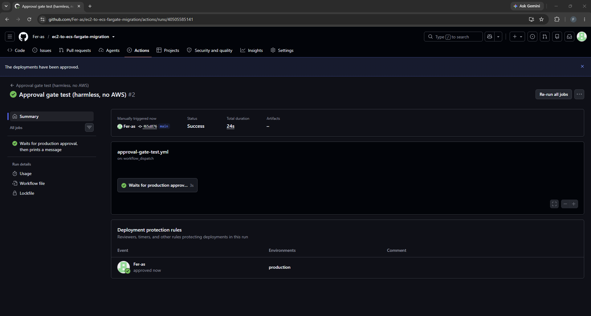

# Evidence index

This page lists every piece of proof in the repository, grouped by what it demonstrates.
All of it is real captured output, screenshots or GitHub Actions runs. Folder names
follow the order of the project's tasks (`task-NN-…`), and each file is dated in its
header.

- **Earlier evidence:** collected locally or offline before the live run. Each folder
  says what it does *not* prove.
- **Live AWS evidence:** from 28 October 2026. The platform was decommissioned after
  capture, so AWS links in older files no longer work.
- **Privacy:** the account ID, IP addresses and CIDRs are redacted. No Terraform state
  or plan files are published.

| # | Capability | What was demonstrated | Proof | Outcome | Limits |
|---|---|---|---|---|---|
| 1 | Container image and hardening | Multi-stage build, digest-pinned base, non-root UID 10001, read-only root filesystem, `--cap-drop ALL`, health check, graceful stop, Trivy scan | [task-04-container](task-04-container/README.md): [build and size](task-04-container/01-docker-build.txt), [non-root](task-04-container/04-non-root-verification.txt), [security run](task-04-container/07-security-validation.txt), [Trivy summary](task-04-container/08b-trivy-summary.txt) | Image 188 MB locally; 17/17 smoke checks | Unfixed base-image CVEs are exceptions ([security-exceptions.md](../docs/security-exceptions.md)); builds aren't bit-reproducible ([10-reproducibility](task-04-container/10-reproducibility.txt)) |
| 2 | Application tests and shared DynamoDB state | The in-memory defect reproduced; the DynamoDB backend shared across containers and workers; concurrent oversell attempt; outage handling | [task-05-shared-state](task-05-shared-state/README.md), [02-docker-shared-state](task-05-shared-state/02-docker-shared-state.txt) | 24 concurrent orders against 50 units: exactly 16 accepted, stock 2 | DynamoDB Local, not AWS |
| 3 | Terraform quality and security checks | `fmt`, `validate`, mocked `terraform test` for both roots, Checkov, EC2 user data tested against DynamoDB Local | [task-06-terraform](task-06-terraform/README.md), [task-07 Checkov](task-07-cicd/03-checkov.txt) | Checkov 334 passed, 0 failed, 30 reviewed exceptions | Mocked providers; AWS behaviour was proven later (row 7) |
| 4 | CI/CD gates and negative tests | actionlint, yamllint, shellcheck, gitleaks, pip-audit, Trivy gate; each gate shown failing on bad input; unsafe workflow variants rejected | [task-07-cicd](task-07-cicd/README.md), [06-negative-tests](task-07-cicd/06-negative-tests.txt), [task-13-precommit](task-13-precommit/01-summary.txt), [task-16 workflow tests](task-16-predeployment/02-workflow-policy-negative-tests.txt) | Green [CI](https://github.com/Fer-as/ec2-to-ecs-fargate-migration/actions/workflows/ci.yml) and [Terraform CI](https://github.com/Fer-as/ec2-to-ecs-fargate-migration/actions/workflows/terraform-ci.yml) runs on `main` | PR and push workflows have no AWS access and never push images |
| 5 | OIDC and IAM least privilege | Plan, image-push and apply roles with exact OIDC subjects; policy simulation and Access Analyzer; read-only account inventory | [task-10](task-10-bootstrap-plan/01-summary.txt), [task-11](task-11-iam-hardening/01-summary.txt), [task-12](task-12-iam-blockers/01-summary.txt), [IAM matrix](../docs/iam-permission-matrix.md) | Access Analyzer: no findings on all 7 policies ([05-access-analyzer](task-12-iam-blockers/05-access-analyzer.txt)); regional-deny regression tests | Two live gaps were found and fixed later: [AMI owner](task-22-runinstances-denial/01-investigation.txt) and EIP disassociation |
| 6 | Production approval gate | The `production` environment blocks a job until approved; a rejection stops it | [approval-gate-test.md](../docs/approval-gate-test.md); screenshots below; runs [40504794430](https://github.com/Fer-as/ec2-to-ecs-fargate-migration/actions/runs/40504794430) (rejected) and [40505585141](https://github.com/Fer-as/ec2-to-ecs-fargate-migration/actions/runs/40505585141) (approved) | Reject = job never ran; approve = job ran | One maintainer, so this is an operator checkpoint, not an independent review |
| 7 | Progressive migration (live AWS) | 90/10 → 50/50 → 0/100, each one reviewed, approved deploy followed by a monitored hold of at least 15 minutes | [live-migration-2026-10-28](live-migration-2026-10-28/README.md); runs [40713560064](https://github.com/Fer-as/ec2-to-ecs-fargate-migration/actions/runs/40713560064), [40719498237](https://github.com/Fer-as/ec2-to-ecs-fargate-migration/actions/runs/40719498237), [40727166757](https://github.com/Fer-as/ec2-to-ecs-fargate-migration/actions/runs/40727166757) | 600/600, 390/390 and 350/350 HTTP 200; sampled ECS share 9.3 %, 48.2 %, 100 % | Sampled requests, not continuous uptime |
| 8 | Rollback and restoration (live AWS) | 100 % ECS → 100 % EC2 → 100 % ECS through the same reviewed pipeline | Runs [40736488690](https://github.com/Fer-as/ec2-to-ecs-fargate-migration/actions/runs/40736488690) and [40739889980](https://github.com/Fer-as/ec2-to-ecs-fargate-migration/actions/runs/40739889980); [sanitised excerpts](live-migration-2026-10-28/excerpts/) | 300/300 via EC2, then 350/350 via ECS; no data divergence | Rollback is manual: fixed weights don't fail over by themselves |
| 9 | Monitoring and data consistency (live AWS) | Six CloudWatch alarms, target health, 5xx metrics, consistent DynamoDB scans and a comparison of both backends at every observation | [Monitoring results](live-migration-2026-10-28/README.md#monitoring-results), [shared DynamoDB test](live-migration-2026-10-28/README.md#shared-dynamodb-test) | All six alarms `OK`; 0 × 5xx; orders [1, 2], stock 98, revenue 59.98 | CloudWatch publishes 1–3 minutes late |
| 10 | Incident handling | First-apply failure and IAM denials diagnosed and fixed narrowly before the cutover | [task-21-deploy-failure](task-21-deploy-failure/01-incident.txt), [task-22-runinstances-denial](task-22-runinstances-denial/01-investigation.txt), [earlier deployments](live-migration-2026-10-28/README.md#earlier-deployments-incidents-fixed-before-the-cutover) | Each fix tested and committed; the cutover then ran cleanly | — |
| 11 | Final AWS teardown | Reviewed saved plans; the shared OIDC provider and state bucket kept | [aws-teardown-2026-10-28](aws-teardown-2026-10-28/README.md) | Platform 70 destroyed, bootstrap 16 destroyed (targeted), 11 images deleted, no project resources left | Billing data lags |

Supporting reviews: [task-08-readiness](task-08-readiness/README.md),
[task-14-public-readiness](task-14-public-readiness/01-audit.txt),
[task-16-predeployment](task-16-predeployment/01-summary.txt), and the
[acceptance checklist](../docs/acceptance-checklist.md).

## Screenshots: production approval gate (27 October 2026)

These were captured on GitHub with the harmless approval-gate workflow, before any AWS
deployment. They show only public repository information.

| Waiting for review | Rejected: job never ran | Approved: job ran |
|---|---|---|
|  |  |  |

No AWS console screenshots are published. The live results are recorded as sanitised
monitor output and linked GitHub Actions runs instead.
